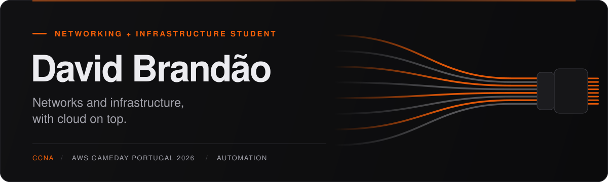

  

  
  
  
  

  <a href="https://www.linkedin.com/in/davidsbrandao"><b>LinkedIn</b></a>
  &nbsp;&nbsp;/&nbsp;&nbsp;
  <a href="mailto:david.s.brandao@outlook.com"><b>Email</b></a>
  &nbsp;&nbsp;/&nbsp;&nbsp;
  <a href="./David_Brandao_CV.pdf"><b>View CV</b></a>

  
    <a href="#selected-projects">Projects</a> &nbsp;·&nbsp;
    <a href="#certifications">Certifications</a> &nbsp;·&nbsp;
    <a href="#technical-toolkit">Toolkit</a> &nbsp;·&nbsp;
    <a href="#github-activity">Activity</a> &nbsp;·&nbsp;
    <a href="#lets-connect">Connect</a>
  

## About me

I'm a final-year **Informatics Engineering student at ISEP** (graduating 2027), focused on **networking and infrastructure**: routing and switching, enterprise networks, virtualization and the systems underneath applications. I'm **CCNA certified** and I'm studying towards CCNP Enterprise.

I also work with **AWS and cloud architecture**. I finished **1st in Portugal at AWS Community GameDay Europe 2026** as part of a team, I build serverless projects with Terraform, and I write about cloud on AWS Builder Center.

## What I enjoy

- **Enterprise networking**: routing, switching, redundancy, segmentation and troubleshooting on real Cisco hardware.
- **Infrastructure and automation**: Linux, Ansible and Terraform to make environments reproducible.
- **Cloud and solutions**: AWS architectures, from VPC design to event-driven backends.
- **Homelab**: a self-hosted Ubuntu and Docker server with WireGuard VPN, DNS filtering and monitoring.

## Selected projects

<table>
  <tr>
    <td colspan="2" valign="top">
      01 / NETWORKING &amp; AUTOMATION
      <h3><a href="https://github.com/david-s-brandao/automated-cisco-campus-network">Automated Multi-Site Network</a></h3>
      
Designed and validated a <b>three-site lab on physical Cisco hardware</b>, using OSPF over GRE/IPsec, VLANs and HSRP. Built Ansible tooling for configuration backups and operational checks, with documentation distinguishing configured intent from verified live state.

      
<code>Cisco IOS</code> <code>OSPF</code> <code>GRE/IPsec</code> <code>HSRP</code> <code>Ansible</code>

      
<a href="https://github.com/david-s-brandao/automated-cisco-campus-network#lab-demonstrations">See the lab &rarr;</a>

    </td>
  </tr>
  <tr>
    <td width="50%" valign="top">
      02 / CLOUD ARCHITECTURE
      <h3><a href="https://github.com/david-s-brandao/risk_assistant">Risk Assistant</a></h3>
      
A serverless threat-analysis backend built for a <b>48-hour team hackathon</b>. I designed and implemented the AWS architecture, from authenticated APIs to asynchronous processing and Amazon Bedrock integration.

      
<b>Engineering focus:</b> SQS with a dead-letter queue, content caching, and an architecture review documenting recovery, IAM and fail-safe improvements.

      
<code>AWS</code> <code>Terraform</code> <code>Python</code> <code>Bedrock</code>

      
<a href="https://github.com/david-s-brandao/risk_assistant#architecture">Explore the architecture &rarr;</a>

    </td>
    <td width="50%" valign="top">
      03 / PERFORMANCE &amp; OBSERVABILITY
      <h3><a href="https://github.com/david-s-brandao/runtime_benchmark_lambda">Lambda Runtime Benchmark</a></h3>
      
Compared <b>Rust, Java 21 and Java 21 + SnapStart</b> across <b>2,000 successful invocations per configuration</b>, with automated workloads and CloudWatch log analysis.

      
<b>Measured in this run:</b> Rust had ~10× lower observed cold-invocation latency, ~78% lower memory use and ~81% lower billed duration than baseline Java.

      
<code>Lambda</code> <code>Rust</code> <code>Java 21</code> <code>CloudWatch</code>

      
<a href="https://github.com/david-s-brandao/runtime_benchmark_lambda#at-a-glance">Read the results &rarr;</a>

    </td>
  </tr>
</table>

## Certifications

| Certification | Status |
| :--- | :--- |
| **Cisco Certified Network Associate (CCNA 200-301)** | Certified · August 2026 |
| **AWS Solutions Architect – Associate (SAA-C03)** | Training completed at ISEP Academy · exam pending |
| **Cisco CCNP Enterprise (ENCOR, ENARSI)** | Studying |

## Currently

- Studying **CCNP Enterprise** content: BGP, advanced OSPF, redistribution and high availability.
- Preparing my final-year internship, with a focus on **network engineering**.
- Growing my homelab towards **Proxmox, VLANs and firewalls**.

## Technical toolkit

  

| Area | Technologies |
| :--- | :--- |
| **Networking** | TCP/IP · IPv4/IPv6 · VLANs · STP · EtherChannel · OSPF · HSRP · GRE/IPsec · NAT · ACLs · DHCP · WireGuard |
| **Infrastructure & automation** | Linux · Ansible · Terraform · Docker · Bash · Git |
| **Cloud & AWS** | VPC · EC2 · Lambda · API Gateway · SQS/SNS · S3 · DynamoDB · Bedrock · CloudWatch · IAM · RDS |
| **Programming** | Python · Java · C · C# · SQL |

## Highlights

- **AWS Community GameDay Europe 2026**: 1st place in Portugal as part of an ISEP Academy team, 80th of 427 teams across Europe.
- **Best Project Award @ ISEP**: [All Aboard](https://github.com/david-s-brandao/All-Aboard), a first-year integrative engineering project.
- **ISEP Academy**: Cisco CCNA and AWS Solutions Architect training.

## Writing

I write about cloud architecture, reliability and fundamentals on **AWS Builder Center**.

- [AI Is Making Fundamentals More Important, Not Less](https://builder.aws.com/content/3IkU8g3AArOpQsxy2TvpZz2ayF3/ai-is-making-fundamentals-more-important-not-less)
- [What If I Randomly Tried To Kill Your AWS Infrastructure?](https://builder.aws.com/content/3IvYf0HUrzoqaTfEvreXNUjEi8u/what-if-i-randomly-tried-to-kill-your-aws-infrastructure)
- [Here's What You Need to Know About AWS TechU](https://builder.aws.com/content/3JsgGDNBmnkuEeClSRzrkbpiMqG/heres-what-you-need-to-know-about-aws-techu)

## GitHub activity

Learning, experimenting and building — one contribution at a time.

<picture>
  <source media="(prefers-color-scheme: dark)" srcset="https://raw.githubusercontent.com/david-s-brandao/david-s-brandao/output/github-contribution-grid-snake-dark.svg" />
  <source media="(prefers-color-scheme: light)" srcset="https://raw.githubusercontent.com/david-s-brandao/david-s-brandao/output/github-contribution-grid-snake.svg" />
  
</picture>

Generated from my GitHub contributions · refreshed daily

## Let's connect

Interested in **networking, infrastructure or cloud architecture**? Get in touch.

  <a href="https://www.linkedin.com/in/davidsbrandao"><b>Connect on LinkedIn &rarr;</b></a>
  &nbsp;&nbsp;·&nbsp;&nbsp;
  <a href="mailto:david.s.brandao@outlook.com"><b>Send me an email &rarr;</b></a>

---

  Portuguese (native) · English (C1)

